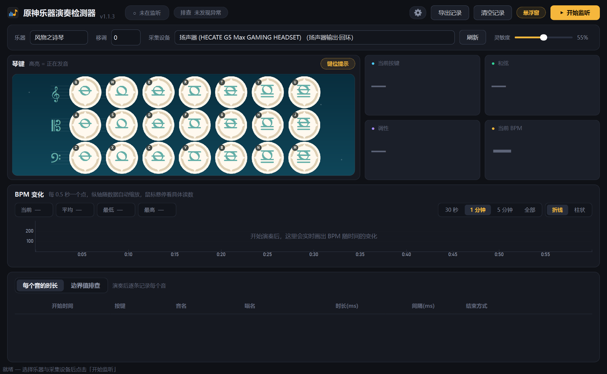

# 原神乐器演奏检测器

**在提瓦特弹琴，把演奏留下来。**

原神乐器演奏检测器是一款《原神》演奏观察与记录工具。它听取游戏声音，把识别到的音符、和弦、节奏变化和音符时长显示在桌面上，方便你边弹边看，或在演奏后对照录音复盘。

[下载 Windows 版](https://github.com/hutao48/genshinimpact-py.found/releases/latest) · [English](docs/README.en.md) · [第一次使用](#第一次使用) · [完整使用说明](使用说明.md) · [反馈问题](https://github.com/hutao48/genshinimpact-py.found/issues)



*Windows 桌面主窗口；也可使用常驻前台的悬浮窗观察演奏。*

## 它能帮你做什么

| 你想了解的事 | 在原神乐器演奏检测器里可以看到 |
|---|---|
| 刚才弹了哪些音 | 对应琴键高亮，并显示音名与键位 |
| 这段演奏的节奏如何变化 | 当前 BPM，以及随时间变化的图表 |
| 哪些音一起响起 | 和弦名称、转位与调性估计 |
| 一个音响了多久 | 起音时间、时长、与前一个音的间隔及结束方式 |
| 哪些片段值得进一步核对 | 「边界值排查」列出的异常同时发声数、节奏网格等线索 |
| 想把这次演奏留作记录 | 导出音符、BPM 和排查结果的 CSV 文件，可用 Excel 打开 |

原神乐器演奏检测器根据**声音**估计演奏情况，不读取游戏里的实际按键。背景声、乐器音色、密集和弦与快速连按都会影响结果，适合辅助观察和复盘。

## 下载与安装

到 [GitHub Releases](https://github.com/hutao48/genshinimpact-py.found/releases) 打开对应版本，按你的使用习惯选择：

| 文件后缀 | 适合你，如果…… | 使用方式 |
|---|---|---|
| `-win64-setup.exe` | 想长期使用，希望有开始菜单或桌面快捷方式 | 运行安装程序，再从快捷方式打开 |
| `-win64-portable.exe` | 想先试试，或者随身带着用 | 下载后直接运行 |
| `SHA256SUMS-windows.txt` | 想核对下载文件是否完整 | 用其中的 SHA-256 校验和比对文件 |

Windows 安装版与免安装版都不需要另外安装 Python。

> **版本说明：**Windows 当前版本号为 **1.1.5**，Android 为 **1.1.1**。1.1.5 修复导出、修复悬浮窗 BPM 曲线刷新，并把悬浮窗改为「右上 BPM 走向 + 右下 MIDI 风格按键时间线」；悬浮窗默认关闭。本次仅更新 Windows，不发布新 APK。

仓库也保留了 Android 麦克风版本的源码。手机端的功能与桌面版不同，下载 APK 前请先看对应 Release 的说明。

## 第一次使用

1. **选好乐器。**打开原神乐器演奏检测器，在顶部选择你在游戏中使用的乐器。
2. **选对声音来源。**在「采集设备」中，选择实际播放游戏声音的设备对应的「扬声器输出·回环」。它会直接听取电脑播放的声音，通常不需要用麦克风对着扬声器录音。
3. **点击「开始监听」，然后演奏。**有音符被识别时，琴键会亮起；演奏一段后，节奏图和音符记录会逐渐出现。

先用默认的 **55% 灵敏度**即可。背景声也被识别成琴音时，逐步调低；漏音较多时，再适当调高。测试时尽量暂停其他音乐和视频，让游戏里的乐器声更清楚。

演奏结束后，点击「停止监听」查看记录，或用「导出记录」保存 CSV。停止后重新开始，记录会继续累积；想从头记录时，再点「清空记录」。

### 让界面适合你的习惯

打开「设置」，可以选择简体中文、繁體中文、正體中文（臺灣）、English 或日本語，也能选择深色、浅色或跟随系统主题。语言更改在重启后生效。

点击「悬浮窗」可打开常驻前台的小窗口；它**默认关闭**，需要时从顶栏开启。悬浮窗右上是实时 BPM 走向，右下是 MIDI 编辑器风格的按键时间线：横条显示每个键从按下到抬起，同时按下的键会在相邻轨道并排出现。窗口内可切换乐器，标题栏可拖动，右下角可缩放，也可以随时隐藏。「键位提示」可显示或隐藏键盘字母，BPM 图可在折线和柱状图之间切换。

更新检查默认关闭。你可以在设置里手动检查新版本，或按需要开启启动检查与自动更新。

### 支持哪些乐器

以下是 Windows 桌面版的乐器布局：

| 乐器 | 布局 |
|---|---|
| 风物之诗琴、镜花之琴、跃律琴、谐律键琴 | 21 键，三排白键，C3–B5 |
| 晚风圆号 | 14 键，两排白键，C4–B5 |
| 悠可琴 | 14 个音高键与 7 个和弦键 |

不同乐器的识别表现有差别。选择与游戏一致的乐器，能帮助程序正确处理音域和谐波。具体键位见 [完整使用说明](使用说明.md)。

### 声音来自另一台设备时

可以改选麦克风或线路输入，听取手机、另一台电脑或外接设备的声音。设备接入后没有出现在列表里，先点「刷新」。

## 怎么看懂这些记录

### BPM：看节奏，也留意分拍方式

BPM 表示估计的每分钟拍数。程序会尝试跟随演奏速度，而不是简单地把每一个音都当成一拍。

没有明显重音的快速轮指、复杂节奏，或乐句刚开始时，读数可能不稳定，也可能显示成你预期拍速的一半或两倍。观察一整段的变化，再结合原曲或节拍器判断，会比只看某一个数字更有帮助。

### 时长：有时记录的是余音

音符表中的「结束方式」能帮助你理解时长的含义：

| 结束方式 | 可以怎样理解 |
|---|---|
| 松键／截止 | 声音出现明显截止，程序据此估计结束时刻 |
| 同键重按 | 同一个音再次起音，上一条记录在重按处结束 |
| 余音自然衰减 | 声音逐渐变弱，记录的是余音可辨的长度 |

诗琴这类拨弦乐器，松手后余音还会继续，因此音符时长通常不能直接当作手指按住键的时间。圆号的声音更接近按住时长，但仍会受到背景声、混响和同时发声的其他音影响。

### 边界值排查：提供线索，留给你复核

「边界值排查」会列出一些值得结合原始录音核对的片段，例如同时发声数偏多、很长一段起音过于规整，或圆号时长呈现明显的量化规律。

**它不能仅凭声音断定一个人是否使用了脚本。**谐波可能被识别成额外的音，游戏音频本身也有时间量化；请结合实际演奏画面与其他证据判断。

## 遇到问题时，先试试这些

| 遇到的情况 | 可以先做什么 |
|---|---|
| 游戏有声音，原神乐器演奏检测器却没有反应 | 确认选中了正在播放游戏声音的输出设备对应的回环；切换耳机或声卡后，刷新并重选设备 |
| 没弹琴，琴键也在亮 | 暂停其他音乐和视频，降低游戏背景音乐或环境音，再逐步调低灵敏度 |
| 大幅调小游戏音量后识别变差 | 停止监听后重新开始，让程序重新学习当前音量 |
| 某些音识别成了高八度或其他键 | 先确认乐器选择正确；只有整体音高基准不符时，再用「移调」校准 |
| BPM 时高时低，或与预期差一倍 | 多演奏一段有明确节拍的乐句，观察读数是否稳定，并留意分拍方式的差别 |
| 启动时提示缺少 PySide6 或 QtCore | 使用完整的对应版本安装包或免安装包，并确认打开的是新文件；反馈时附上版本和完整报错 |

仍有问题，可以到 [Issues](https://github.com/hutao48/genshinimpact-py.found/issues) 留言。描述你使用的版本、乐器、采集设备和具体表现；如果能附一小段可复现的录音或录像，会更方便定位。

程序日志位于：`%LOCALAPPDATA%\GenshinInstrumentDetector\app.log`。

## 已经录好的演奏，也可以分析

桌面版支持离线分析 WAV 录音。例如，在 PowerShell 中运行：

```powershell
.\原神乐器演奏检测器.exe --analyze ".\演奏.wav" ".\分析.txt" "风物之诗琴"
```

报告会列出演奏中的音符、时长、间隔、BPM、调性和排查结果。若录制的是视频，可以先用 FFmpeg 提取声音：

```powershell
ffmpeg -i ".\演奏.mp4" -vn -ac 1 -ar 48000 ".\演奏.wav"
```

## 想从源码运行或参与改进

Windows 源码运行需要 Python 与项目依赖。在仓库目录中执行：

```powershell
python -m pip install -r requirements.txt
python main.py
```

打包时使用 [固定版本的构建依赖](packaging/requirements-build.txt)。构建脚本会检查界面依赖、运行回归测试，并验证生成的 EXE 能创建和渲染主窗口。

- [完整使用说明](使用说明.md)：详细键位、界面与操作说明。
- [开发与评测记录](docs/development-and-evaluation.md)：检测原理、历史版本、样本评测、源码结构与打包方法。
- [构建脚本](packaging/build_windows.ps1)：生成 Windows 安装版和免安装版。

如果你愿意分享识别不准的片段、改进建议，或修复一处具体问题，欢迎一起把原神乐器演奏检测器做得更好用。
